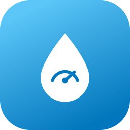

  

<h1 align="center">SURU WaterMonitor for Home Assistant</h1>

  
  

Unofficial Home Assistant integration for the **SURU WaterMonitor** smart water
meter platform (SenseGuard GmbH). It signs in to the SURU cloud with your app
account and exposes your meter reading and water consumption as sensors, ready
for the Home Assistant Energy dashboard.

> [!WARNING]
> This is an **unofficial**, community-built integration. It is **not affiliated
> with, endorsed by, or supported by SenseGuard GmbH / SURU**. It talks to the
> same private cloud API as the official "WaterMonitor" app. The vendor can
> change or restrict the API at any time. Use at your own risk.

> [!NOTE]
> This is a fork of
> [teuffel/homeassistant-suru-watermonitor](https://github.com/teuffel/homeassistant-suru-watermonitor)
> that adds hourly consumption as long-term statistics.

## Features

A device is created per water unit on your account, with these sensors:

| Sensor | Unit | Notes |
|---|---|---|
| Meter reading | m3 | `total_increasing` / `device_class: water` - add **this** to the Energy dashboard |
| Consumption today | L | sum of today's hourly buckets |
| Water hardness | dH | diagnostic |
| pH value | - | diagnostic |
| Last measured | timestamp | diagnostic (data freshness) |
| Alarm | binary | `device_class: problem` - pipe monitor (leak / high flow / temperature); active incident types in attributes |

The readings come from your utility's smart meter via SURU and update roughly
hourly/daily, so the integration polls the cloud once per hour.

### Hourly consumption (long-term statistics)

In addition to the sensors, the hourly consumption buckets (the same values the
app shows per hour) are imported as an external statistic
`suru_water_monitor:<unit_id>_consumption` (litres), **with the real hour they
belong to** - even if the utility delivers the data a day late. On the first run
the last 30 days are backfilled; every update re-imports the last 3 days so late
hours are filled in.

Use it in a **Statistics graph** card (period: hour, stat type: change), or add
it to the Energy dashboard under *Water consumption* instead of the meter
reading to see water use per hour.

## Requirements

- Home Assistant **2024.12** or newer
- A working **SURU WaterMonitor** app account (email + password) with an
  activated meter

## Installation

### HACS (custom repository)

1. HACS -> top-right menu -> **Custom repositories**
2. Add `https://github.com/3dbruce/homeassistant-suru-watermonitor`,
   category **Integration**
3. Install **SURU WaterMonitor**, then **restart** Home Assistant

### Manual

Copy `custom_components/suru_water_monitor/` into your Home Assistant
`config/custom_components/` directory and restart.

## Configuration

Settings -> Devices & Services -> **Add Integration** -> "SURU WaterMonitor" ->
enter your app **email** and **password**.

The polling interval (default 60 min, range 5-1440) can be changed any time via
the integration's **Configure** button (options).

## Energy dashboard

Settings -> Dashboards -> Energy -> **Water consumption** -> add the
**Meter reading** sensor (m3).

## How it works

Authentication is AWS Cognito (`USER_SRP_AUTH`, no client secret) - exactly what
the official app does. The resulting access token is sent as a Bearer token to
the SURU API Gateway. The SRP login is implemented self-contained, so the
integration needs **no extra Python dependencies** (no `boto3`).

## Privacy & legal

- Your credentials are stored by Home Assistant in its config entry and are only
  sent to AWS Cognito (`cognito-idp.eu-central-1.amazonaws.com`) and the SURU API
  over HTTPS.
- This repository contains **no vendor code or app binaries**. It only provides
  an interoperable client, which is permitted for interoperability purposes
  (EU Directive 2009/24/EC Art. 6, German UrhG section 69e). "SURU" and
  "WaterMonitor" are trademarks of their respective owners and are used here only
  descriptively to indicate compatibility.

## License

[MIT](LICENSE)
